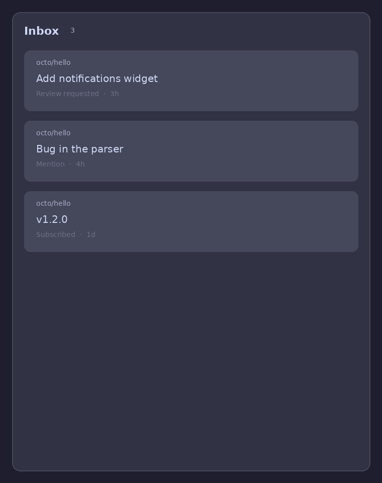

# ghbar

Unread GitHub notifications in the Noctalia bar, with an inbox panel to open and mark them read.



## Why

Unread GitHub notifications only show up in a browser tab at `github.com/notifications`, so they are noticed late or never. Keeping that tab open is noisy and easy to bury under other work. ghbar puts the unread count in the Noctalia bar and the inbox in a panel, so you can open a thread and mark it read without leaving the desktop.

## Status

Alpha (`0.1.0`). Unit-tested on a mocked host and checked by hand in Noctalia v5; GitHub Enterprise and mark-all-read are out of scope.

## Features

- Unread count in the bar (caps at `50+`), with a dimmed GitHub glyph when the inbox is empty
- Empty inbox: one click opens `github.com/notifications` instead of an empty panel
- Panel lists repository, title, reason and relative time
- Click a row to open the page and mark the thread read
- Optional desktop toast for newly arrived items (off by default)
- Token from `gh auth token` only, never written to disk by the plugin

## Quick start

Requires Noctalia v5 (plugin API 22+) and the GitHub CLI logged in with the `repo` scope (`gh auth status`).

```bash
mkdir -p ~/.local/share/noctalia/plugins
ln -sfn "$PWD" ~/.local/share/noctalia/plugins/ghbar
```

Enable `nandomoreirame/ghbar` in `plugins.toml`, add `nandomoreirame/ghbar:bar` to a bar slot, then restart Noctalia. The GitHub glyph is always visible: dimmed when the inbox is empty, with a count when there are unread items, and an alert glyph on error.

## Usage

- The bar shows the GitHub glyph and the unread count. With unread items (or an error) a click opens the panel; with an empty inbox it opens `https://github.com/notifications` in the browser.
- Each panel row opens the subject in the browser and marks that thread read.
- The refresh button polls immediately.
- On a translucent bar the attached panel inherits the bar opacity. Float it for contrast:

```toml
[plugin_settings."<whoami>/ghbar"]
panel_placement = "floating"
panel_open_near_click = true
```

Replace `<whoami>` with the output of `whoami`. Restart the shell after changing placement.

| Setting | Type | Default | Effect |
| --- | --- | --- | --- |
| `notify_new` | bool | `false` | Desktop toast when a new unread item arrives |

## Development

Needs the `luau` CLI on `PATH`.

```bash
./run-tests
./run-tests tests/service.test.luau
noctalia plugins lint .
```

## Security

- **Token:** obtained with `gh auth token` and held only in callback locals and the `Authorization` header of `noctalia.http`. Never stored in `noctalia.state`, logs, files, argv or notifications.
- **Network:** `GET https://api.github.com/notifications?per_page=50` every 60 s; `PATCH https://api.github.com/notifications/threads/{id}` when a row is opened. No other hosts.
- **Commands:** `gh auth token` for the token; `xdg-open` only for `https://github.com/...` URLs derived from the API answer, or the fixed `https://github.com/notifications` on an empty-inbox click.
- **Listeners:** none. The plugin opens no port and runs no server.
- **Writes:** the only GitHub write is marking a single thread read. There is no bulk mark-all.
- **Limitation:** the plugin needs only the `notifications` scope, but it uses whatever token `gh` holds, which usually has broader scopes (for example `repo`). Use `gh auth refresh` or a narrower login if that matters to you.
- **Reporting:** open a private report through the repository's Security tab (GitHub private vulnerability reporting).

## Repository scope

The repository holds the plugin only. `CLAUDE.md` is guidance for AI coding agents; humans start here. `docs/specs`, `docs/plans` and `docs/reviews` keep the spec, plan and review records that drove the build, and `docs/STYLEGUIDE.md` comes from the plugin scaffold.

## Contributing

Issues and pull requests are welcome. Run `./run-tests` and `noctalia plugins lint .` before opening one. The spec and plan that drove the build are in `docs/specs/ghbar/` and `docs/plans/`.

## License

MIT, Fernando Moreira Costa. See [LICENSE](LICENSE).
